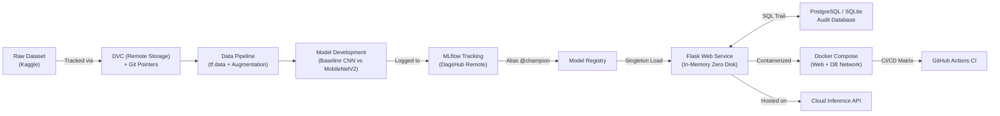

# VisionGuard: AI vs Real Image Classification & MLOps Deployment


---

## 📌 Project Overview
**VisionGuard** is an end-to-end production MLOps system that classifies whether an uploaded image is **AI-generated** or **Real**.

- **Student Name:** Bissam Iftikhar
- **Roll Number:** `23L-0913`
- **Course:** MLOps (CS / AI / Data Science) — Assignment 2 (100 Marks)
- **Repository:** [`23L-0913_A2_Ops`](https://github.com/bissamiftikhar/23L-0913_A2_Ops)
- **DagsHub Project:** [https://dagshub.com/bissamiftikhar/23L-0913_A2_Ops](https://dagshub.com/bissamiftikhar/23L-0913_A2_Ops)
- **Live Cloud Inference API:** `https://visionguard-23l0913.onrender.com/api/predict` (or local fallback `http://localhost:5001/api/predict`)

---

## 🏗️ Architecture & Core Components



---

## 🚀 Quickstart Guide

### 1. Local Environment Setup
```bash
# Clone the repository
git clone https://github.com/bissamiftikhar/23L-0913_A2_Ops.git
cd 23L-0913_A2_Ops

# Create & activate Python 3.12 virtual environment
python3.12 -m venv .venv
source .venv/bin/activate

# Install dependencies
pip install -r requirements.txt

# Configure environment variables
cp .env.example .env
# Edit .env with your DagsHub token and secrets
```

### 2. Run Data Pipeline & Model Training
```bash
# 1. Environment & GPU check (Task 1.1)
python src/task1_env_check.py

# 2. Download, audit, deduplicate & generate EDA splits (Task 1.2 & 1.3)
python src/task1_dataset_audit_and_eda.py

# 3. DVC tracking workflow (Task 1.4)
bash src/task1_4_dvc_workflow.sh

# 4. Keras Tuner hyperparameter search (Task 2.7)
python src/task2_keras_tuner.py

# 5. Train Baseline CNN, MobileNetV2, evaluate & generate Grad-CAM (Task 2.2 - 2.6 & Bonus)
python src/task2_train_and_eval.py

# 6. Log experiments and register champion model to DagsHub MLflow (Task 3)
python src/task3_experiment_tracking.py

# 7. Test loading champion model by alias (Task 3.6)
python src/load_champion_model.py
```

### 3. Run Web Application
```bash
# Run Flask web server locally (Debug mode OFF)
python app.py
# Access UI at: http://localhost:5001
```

### 4. Run with Docker Compose (Task 6)
```bash
# Start multi-container stack (Flask Web App + Isolated PostgreSQL Database)
docker compose up -d --build

# Verify container statuses and health
docker compose ps

# Access live app at: http://localhost:5001
# View health check: http://localhost:5001/health
# View DB audit trail: http://localhost:5001/history

# Stop services cleanly
docker compose down
```

---

## 🔒 Security & Workflow Secrets Note (Task 6.6)
Workflow secrets (`DAGSHUB_USER_TOKEN`, database passwords, API secret keys) are securely stored in **GitHub Repository Settings $\rightarrow$ Secrets and variables $\rightarrow$ Actions** and injected dynamically as environment variables at runtime. 
**Secrets are strictly prohibited from appearing in the workflow YAML file or being committed to Git**, preventing credential leaks and supply-chain exploits.

---

## 📊 Summary of Tasks & Mark Distribution
| Task | Description | Marks | Evidence |
|---|---|---|---|
| **Task 1** | Data Understanding, SHA-256 Audit, EDA, DVC Toy Lab & Application | 7 | Audit table, Histograms, DVC commit logs |
| **Task 2** | `tf.data` Pipeline, Baseline CNN, MobileNetV2 Fine-Tuning, Keras Tuner, Evaluation, Error Analysis + Grad-CAM | 14 + 1 | Curves, Confusion Matrix, ROC, 10-error grid, Grad-CAM heatmaps |
| **Task 3** | Local MLflow Lab, DagsHub Remote Server, 6-Run Comparison Matrix, Model Registry (`@champion`) | 12 | MLflow screenshots, Comparison table, Alias load terminal |
| **Task 4** | Flask Web App, Singleton In-Memory Inference, Multi-Layer Validation, Friendly Errors | 12 | Upload/Result UI, 3 rejection failure cases, `/health` response |
| **Task 5** | Database Trail (SQLite/PostgreSQL) logging every query, confidence, and timestamp | 8 | History view screenshot, DB query logs |
| **Task 6** | Docker Warm-up, Layer-Cached Non-Root Dockerfile, Compose Stack, Failure Diagnosis, GitHub Actions CI | 14 | Docker outputs, Compose status, Log diagnosis, CI Badge |
| **Task 7** | Cloud API Deployment (Publicly accessible model endpoint) | 15 | Postman test screenshot, Cloud API URL |
| **Task 8** | Integration of Local Flask View with Cloud API & DB audit logging | 15 | Multi-input screenshots, Live integration logs |
| **Report**| Comprehensive PDF Report (`23L-0913_VisionGuard.pdf`) | Deliverable | Complete submitted PDF with all screenshots & commentary |
| **Total** | | **100 + 1** | |

